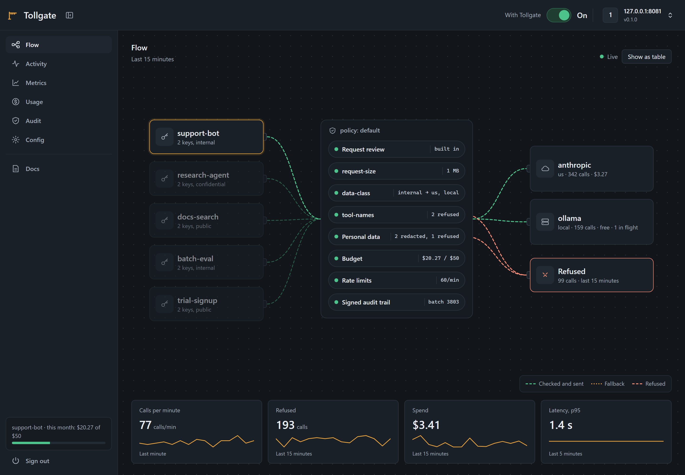

# Tollgate

[](https://github.com/Jamal-Akhras/tollgate/actions/workflows/ci.yml)
[](https://github.com/Jamal-Akhras/tollgate/actions/workflows/codeql.yml)
[](https://scorecard.dev/viewer/?uri=github.com/Jamal-Akhras/tollgate)
[](LICENSE)

**A policy and audit gateway for LLM traffic.** Tollgate sits between your
applications and model providers. For every request it decides whether it may
go, where it may go and what it may cost, and it records that decision in a
signed audit trail that shows when a record has been changed or removed.

It is built for teams that have to answer four questions about any model call:
what was sent, who sent it, what it cost, and why it was allowed.

> **Status: 0.1.0, the first release.** What comes next is on the
> [roadmap](#roadmap).



- [What it does](#what-it-does)
- [Quickstart](#quickstart)
- [Client libraries](#client-libraries)
- [The console](#the-console)
- [Inside a Spring Boot application](#inside-a-spring-boot-application)
- [Operating it](#operating-it)
- [Building](#building)
- [Roadmap](#roadmap)
- [Documentation](#documentation)

## What it does

- **Your SDKs, unchanged.** It serves the OpenAI chat completions API and the
  Anthropic messages API, so an SDK connects by changing its base URL.
  Requests are forwarded in their own format, and streams are relayed as they
  arrive ([ADR 0005](docs/adr/0005-forward-requests-in-their-own-format.md)).
- **Tenants, keys and data classes.** Each application gets a tenant with its
  own hashed keys, its own models and a data class that decides which regions
  its requests may reach. Guards fail closed.
- **Only reviewed requests leave.** Fields, tools and content are checked
  against an allowlist, and a `tool-names` guard can refuse tools by name
  ([ADR 0008](docs/adr/0008-harden-the-request-path.md),
  [ADR 0024](docs/adr/0024-refuse-tools-by-name.md)).
- **Personal data stays home.** A policy can replace emails, card numbers,
  IBANs and more before a request leaves and put them back in the answer, and
  refuse secrets ([ADR 0012](docs/adr/0012-redact-personal-data.md)).
- **Budgets with exact money.** The most a call can cost is reserved first and
  settled from reported usage, in integer nano-units
  ([ADR 0006](docs/adr/0006-budget-reservations.md)).
- **Prices from a reviewed catalog,** so you don't type them
  ([ADR 0009](docs/adr/0009-price-catalog.md)).
- **Limits and fallback.** Rate limits per tenant, concurrency limits per
  provider, and fallback models with a circuit breaker
  ([ADR 0015](docs/adr/0015-tenant-rate-limits.md),
  [ADR 0016](docs/adr/0016-provider-fallback.md)).
- **A tamper-evident audit trail.** Every decision is recorded before the
  provider is called, in Merkle trees signed with Ed25519, and `audit verify`
  names the batch that no longer matches ([ADR 0007](docs/adr/0007-audit-trail.md)).
- **Calls per person** through a configurable user header, recorded as an HMAC
  ([ADR 0023](docs/adr/0023-attribute-calls-to-a-user.md)).
- **Try a guard before it refuses,** with `mode: monitor`
  ([ADR 0022](docs/adr/0022-shadow-mode.md)).
- **Metrics, traces and a Grafana dashboard**
  ([operating it](docs/operations.md)).
- **A console, a Spring Boot starter and client libraries** for Python,
  TypeScript and Java, and a non-root image on a distroless base.

The full list is in [what works today](docs/features.md).

## Quickstart

You need Java 25, and a model server that speaks the OpenAI API. This example
uses [Ollama](https://ollama.com) on its default port, with `qwen3:8b` pulled.

**1. Download the server** from the
[latest release](https://github.com/Jamal-Akhras/tollgate/releases/latest):

```bash
curl -LO https://github.com/Jamal-Akhras/tollgate/releases/download/v0.1.0/tollgate-0.1.0.jar
alias tollgate='java -XX:+ExitOnOutOfMemoryError -jar tollgate-0.1.0.jar'
```

On Windows, in PowerShell:

```powershell
curl.exe -LO https://github.com/Jamal-Akhras/tollgate/releases/download/v0.1.0/tollgate-0.1.0.jar
function tollgate { java -XX:+ExitOnOutOfMemoryError -jar tollgate-0.1.0.jar @args }
```

**2. Create a config and its secrets.**

```bash
tollgate init
```

- **`tollgate.yaml`** is ready for Ollama with `qwen3:8b`, and holds no secrets
  ([what is in it](docs/configuration.md#the-config-tollgate-init-writes)).
- **`tollgate.env`** holds the audit keys, an admin token, and the line that
  lets the console change `tollgate.yaml`. Only you can read it, and `init`
  never overwrites it. Keep it out of version control and back it up.
- **The API key** for the tenant `my-app` is printed once.

**3. Start Tollgate** with the secrets in its environment:

```bash
set -a; . ./tollgate.env; set +a
tollgate
```

On Windows, in PowerShell:

```powershell
Get-Content tollgate.env | ForEach-Object { $name, $value = $_ -split '=', 2; Set-Item "env:$name" $value }
tollgate
```

The console is at `http://127.0.0.1:8081/console/`; sign in with the admin
token from `tollgate.env`. Remove the `TOLLGATE_ADMIN_EDITS` line from
`tollgate.env` to keep `tollgate.yaml` read-only.

**4. Call it** with the OpenAI SDK, using the tenant key:

```python
from openai import OpenAI

client = OpenAI(base_url="http://localhost:8080/v1", api_key="tg_…")
reply = client.chat.completions.create(
    model="qwen3", messages=[{"role": "user", "content": "Say hello"}]
)
print(reply.choices[0].message.content)
```

A request that breaks a rule is refused in the SDK's own error format, with
the reason, and each response carries an `X-Tollgate-Trace-Id` header that
matches its audit records.

**5. Verify the audit trail** with the `audit.publicKey` from `tollgate.yaml`:

```console
$ tollgate audit verify --public-key MCowBQYDK2VwAyEA… audit
Checked 2 records in 1 sealed batch.
The last batch is 1, sealed at 2026-11-02T14:03:12.100Z with root 9f2c….
The audit trail is intact.
```

Edit any recorded field and run it again: verification fails and names the
batch that no longer matches.

### With Docker

Each version is published as `ghcr.io/jamal-akhras/tollgate:<version>` for
amd64 and arm64. Create the config with the image, as you:

```bash
docker run --rm --user "$(id -u):$(id -g)" -v "$PWD:/work" -w /work \
  ghcr.io/jamal-akhras/tollgate:0.1.0 init
```

In `tollgate.yaml`, point the provider at `host.docker.internal` instead of
`localhost`. Then start it in the same folder:

```bash
docker run -d --name tollgate --user "$(id -u):$(id -g)" \
  -v "$PWD:/work" -w /work -e TOLLGATE_CONFIG=/work/tollgate.yaml \
  --env-file tollgate.env \
  --add-host=host.docker.internal:host-gateway \
  -p 127.0.0.1:8080:8080 -p 127.0.0.1:8081:8081 -p 127.0.0.1:9090:9090 \
  ghcr.io/jamal-akhras/tollgate:0.1.0
```

[Deploying](docs/deploy.md) has the Windows commands, how to check an image's
signed build record, and a systemd service.

## Client libraries

`tollgate-client` gives you the official OpenAI or Anthropic client already
pointed at Tollgate. In Python, `pip install "tollgate-client[openai]"`
installs it. It reads `TOLLGATE_BASE_URL` and `TOLLGATE_API_KEY`:

```python
import tollgate

client = tollgate.openai(data_class="confidential", user="u-17")
raw = client.chat.completions.with_raw_response.create(
    model="qwen3", messages=[{"role": "user", "content": "Say hello"}]
)
print(tollgate.receipt(raw).trace_id)
```

- **TypeScript:** `npm install tollgate-client openai`, then
  `openai()` from `tollgate-client/openai`.
- **Java:** `io.github.jamal-akhras:tollgate-client`, then
  `TollgateOpenAI.builder()`.

Each also reads a call's receipt and why Tollgate refused one
([the libraries](docs/client-libraries.md)). You don't need them: the base URL
works on its own.

## The console

Open `http://127.0.0.1:8081/console/` and paste the admin token. You see calls
flow from tenants through their rules to providers, with live numbers, the
audit trail drawn as Merkle trees with proofs checked in your browser, usage by
tenant, model or user, and the running config. With edits on, it can switch a
guard between `enforce` and `monitor`, set a budget, and create or revoke a
key, each after showing the YAML that changes. It is part of the server jar
([the console](docs/console.md)).

## Inside a Spring Boot application

The same gateway runs inside a Spring Boot 4.1 application on Spring MVC, with
one dependency and a config file
([ADR 0021](docs/adr/0021-spring-boot-starter.md)):

```xml
<dependency>
  <groupId>io.github.jamal-akhras</groupId>
  <artifactId>tollgate-spring-boot-starter</artifactId>
  <version>0.1.0</version>
</dependency>
```

[The starter](docs/spring-boot-starter.md) has the setup and its limits.

## Operating it

| Port | Serves |
|---|---|
| 8080 | The gateway API, for applications |
| 8081 | The admin API, its OpenAPI contract and the console, for operators. Loopback only unless `TOLLGATE_ADMIN_ADDRESS` says otherwise |
| 9090 | Health probes and Prometheus metrics at `/actuator/prometheus`. It listens on all interfaces, and its metrics name your tenants and models and show their spend, so keep it off the public network |

Who can connect, metrics, traces, the admin token, reloads, usage and budgets
and audit modes are in [operating Tollgate](docs/operations.md). A
[Grafana dashboard](docs/grafana/tollgate.json) is included.

## Building

Requires JDK 25. The Maven Wrapper downloads and verifies Maven itself, and
the build downloads a pinned Node into `tollgate-console/target`, checks its
checksum and installs the console's packages from the committed lockfile with
`npm ci --ignore-scripts`. You don't install Node.

```bash
./mvnw -DskipTests install                    # the server jar in tollgate-server/target
./mvnw -pl tollgate-server jib:dockerBuild -Djib.from.platforms=linux/amd64   # the image, locally
./mvnw verify                                 # formatting, Error Prone, NullAway, tests, coverage, API contract
./mvnw -pl tollgate-core -Pmutation verify    # mutation testing on core
./mvnw -Psbom package                         # CycloneDX SBOM in target/bom.json
```

The core module depends only on the JDK and JSpecify, compiles for Java 21,
and is mutation tested. The checks the build enforces are listed under the
[quality bar](docs/DESIGN.md#12-quality-bar). Working on the console or the
libraries is covered in [CONTRIBUTING.md](CONTRIBUTING.md).

## Roadmap

| Release | Scope |
|---|---|
| **0.1.0** | Everything in [what works today](docs/features.md) and the [console](docs/console.md) with four edits, with the core, provider, starter and client libraries on Maven Central, and the `tollgate-client` packages on PyPI and npm |
| **0.1.1** | The first performance report: microbenchmarks and load tests for each audit mode, with the hardware they ran on; a tested Open WebUI setup guide |
| **Next** | The OpenAI Responses API and embeddings, so Codex works; MCP tool calls through Tollgate; GitHub Copilot and Gemini CLI |
| **Later** | Output guards, name detection, CEL rules and webhook guards; Postgres and Redis storage; the console's viewer token, pausing a tenant, more edits and approvals, and TLS on the admin port; Azure OpenAI and Bedrock; a Helm chart and a Terraform example |

The full plan, and the reasoning behind it, is in [the design](docs/DESIGN.md).

## Documentation

[docs/README.md](docs/README.md) lists everything. The main pages:

- [What works today](docs/features.md) and [configuration](docs/configuration.md)
- [Design](docs/DESIGN.md) and the [architecture decision records](docs/adr/README.md)
- [Deploying](docs/deploy.md) and [operating](docs/operations.md)
- [The client libraries](docs/client-libraries.md), [the starter](docs/spring-boot-starter.md) and [the console](docs/console.md)
- [Claude Code through Tollgate](docs/clients/claude-code.md)
- [Admin API contract](docs/api/admin-openapi.json)
- [Contributing](CONTRIBUTING.md) · [Security policy](SECURITY.md) · [Changelog](CHANGELOG.md)

## License

[Apache License 2.0](LICENSE).
