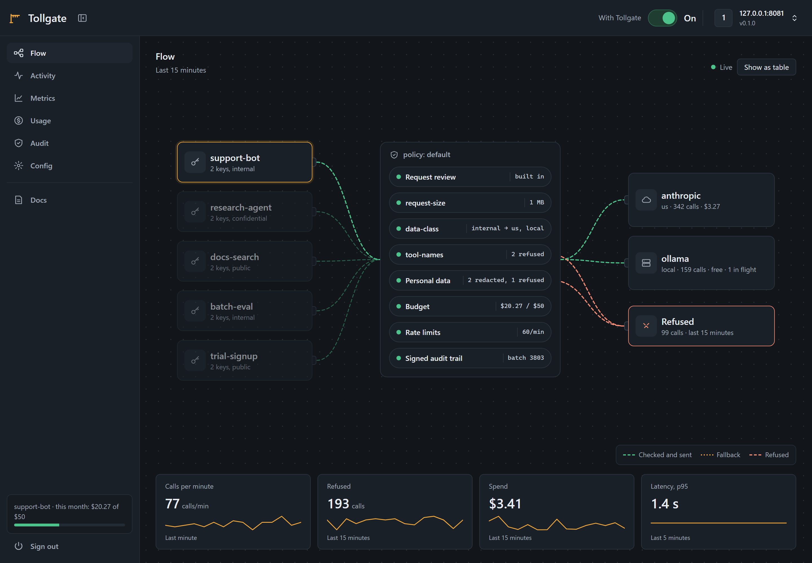
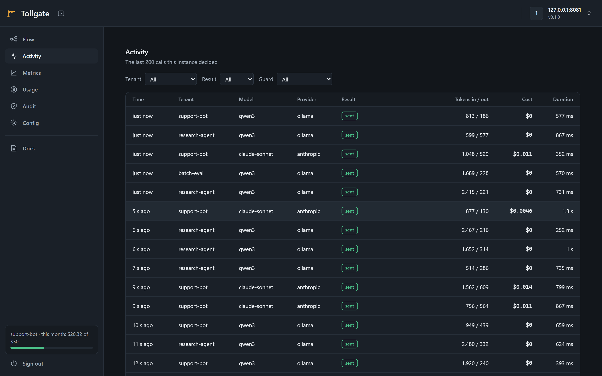
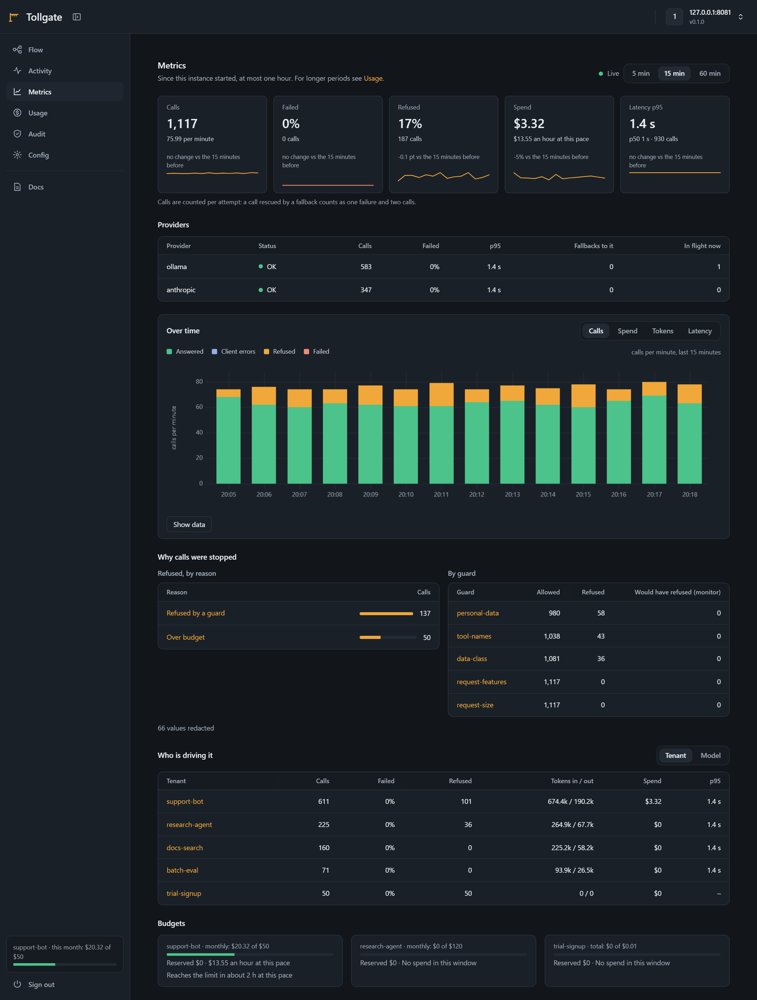
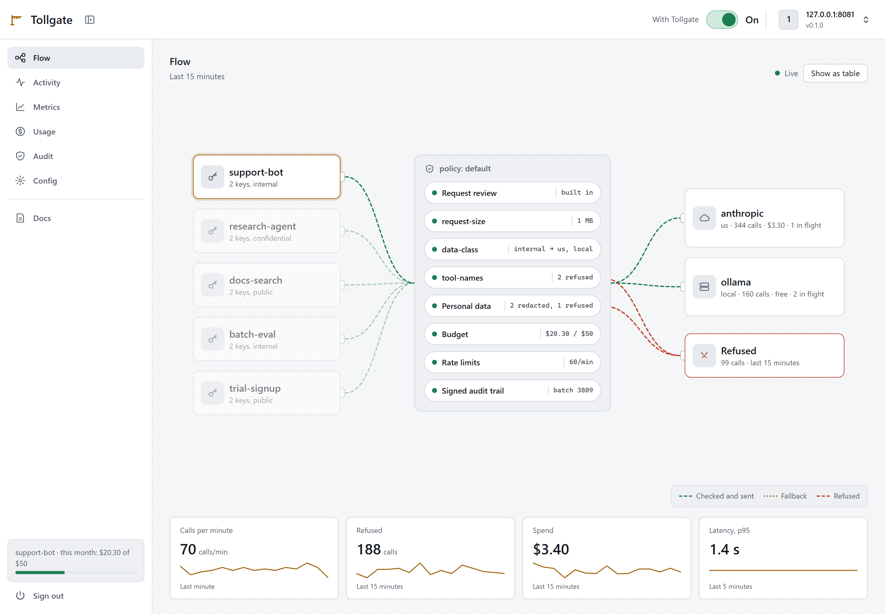

# The console

The console is a web app on the admin port. Start Tollgate, open
`http://127.0.0.1:8081/console/` and paste the admin token from
`tollgate.env`. It is part of the server jar and needs nothing else
([ADR 0025](adr/0025-console-as-a-static-app.md)).



- **Flow** draws every tenant, the rules of the selected tenant's policy and
  its providers. A line moves for anything that had calls in the last 15
  minutes, and faster while calls are passing: green for calls sent, amber
  for fallbacks, red for refusals. Calls, refusals, spend and latency stay at
  the bottom of the page, and a diagram too large for the window is dragged.
  The switch in the top bar shows the picture as it would be without
  Tollgate. It is a preview and changes nothing.
- **Activity** lists the latest calls with each guard's verdict.
- **Metrics** covers the last 5, 15 or 60 minutes: calls, the share that
  failed or was refused, spend and latency, each against the period before;
  each provider's health; one chart of calls, spend, tokens or latency over
  time; why calls were stopped, by reason and by guard; the tenants and
  models behind the traffic; and how fast each budget is being spent. A call
  is counted once for each provider it was sent to, so one rescued by a
  fallback counts twice.
- Flow, Activity and Metrics are counted from the audit trail by one
  background reader, not from the request path, so they start empty after a
  restart and need `audit.mode` on
  ([ADR 0027](adr/0027-live-data-for-the-console.md)).
- **Usage** is the usage report, by tenant, model, key, user or day.
- **Audit** lists the sealed batches, newest first, and says for each whether
  it names the root of the batch before it. A row opens to the batch's
  signature, its Merkle tree and the proof of any record in it. The page
  hashes the record and walks the proof itself, step by step, and a button
  verifies the whole trail
  ([ADR 0028](adr/0028-audit-trail-through-the-admin-api.md)).
- **Config** shows the running config, with Reload. Detector terms and key
  hashes are never shown.





The console is dark by default. The menu under the address in the top bar
switches it to light or to the system's setting.



**Signing in.** The token is kept in the tab's `sessionStorage` and sent by the
console's own code. There is no cookie, so another site's page can't make the
browser call the admin API for you. Closing the tab forgets the token
([ADR 0026](adr/0026-console-sign-in.md)).

**Proofs need HTTPS or localhost.** A browser lets a page hash only on
`localhost` or over HTTPS. Over plain HTTP from another machine, the Audit
page can't check a proof itself. It shows the server's result and says so.
Tollgate doesn't serve TLS yet; put a TLS-terminating proxy in front of the
admin port, or use an SSH tunnel to `localhost`. TLS on the admin port is on
the [roadmap](../README.md#roadmap).

**Edits.** With `TOLLGATE_ADMIN_EDITS=file`, which `tollgate init` writes into
`tollgate.env`, the console can make four changes
([ADR 0029](adr/0029-config-in-the-console.md)):

- switch a guard between `enforce` and `monitor`
- set a tenant's budget, as a limit and a period
- create a key for a tenant, shown once
- revoke a key

Each one shows the lines of YAML that change and asks first. A change that
widens what can happen says so in words, such as monitoring a data-class guard
or revoking a tenant's last key. Calls already running finish when a key is
revoked.

- **The first edit rewrites `tollgate.yaml`** in a fixed layout, and its
  comments are lost. The file as you wrote it is kept beside it as
  `tollgate.yaml.original`.
- **Every version that ran is kept** in `config-history/` next to the file,
  named by the config version, which is the version each audit record names.
  Nothing deletes them.
- **The file must be writable.** With edits on and a file or folder Tollgate
  can't write, it stops at startup and says which path. Remove
  `TOLLGATE_ADMIN_EDITS` for a file that must stay read-only, such as one kept
  in Git. The console then shows the YAML to write, and Reload.
- **A budget's period:** changing it, or setting a first budget, makes the
  reload count the spend again from the audit trail. With the audit trail off,
  the count starts from zero.
- **The same edits are routes** in the [OpenAPI contract](api/admin-openapi.json).
  They need `If-Match` with the running config version, and answer `428`
  without it and `412` if the version or the file has moved. Guards count from
  0, and in the config `tollgate init` writes, guard 0 is the request-size
  guard:

  ```bash
  VERSION=$(curl -s -H "Authorization: Bearer $TOLLGATE_ADMIN_TOKEN" \
    http://127.0.0.1:8081/admin/v1/config | jq -r .version)
  curl -X PUT -H "Authorization: Bearer $TOLLGATE_ADMIN_TOKEN" \
    -H "If-Match: $VERSION" -H "Content-Type: application/json" \
    -d '{"mode":"monitor"}' \
    http://127.0.0.1:8081/admin/v1/policies/default/guards/0/mode
  ```

**Turning it off.** `TOLLGATE_CONSOLE_ENABLED=false` removes the console and its
reader. The admin API stays. The console's files need no token, since they
hold no data, and it loads nothing from other hosts.
